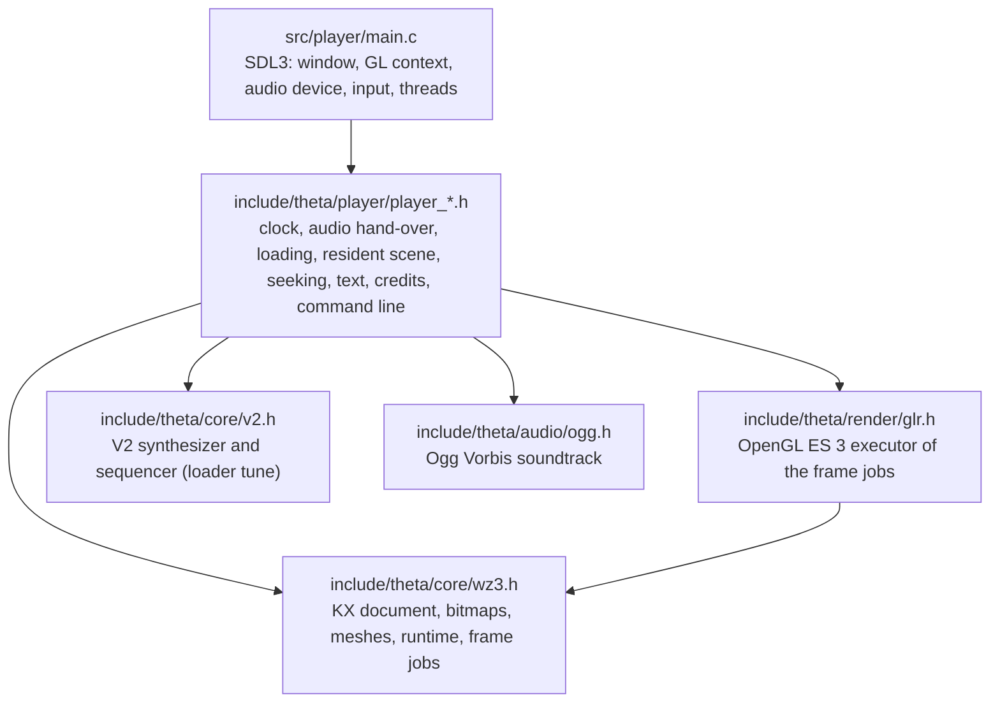

# Architecture

## Layers

Everything below `main.c` is platform independent: no window, no audio device, no file access, no threads. `main.c` is the only file that
includes SDL3 and the only one with a platform `#ifdef` (Emscripten).

| Header | Role |
|---|---|
| `core/wz3.h` (and `core/wz3/*.inc`) | The CPU side of the werkkzeug3 engine: math, the compact KX document reader, procedural bitmaps, meshes and MinMeshes, the runtime (events, animation VM, precalculation of every operator), and the frame jobs a scene produces (materials, lights, draw lists, effects, render and texture plans). |
| `core/v2.h` | The V2 synthesizer and sequencer. The soundtrack of theta is an Ogg file; V2 plays the loader tune of documents that carry one. |
| `audio/ogg.h` | The soundtrack: an Ogg Vorbis stream decoded on demand around stb_vorbis, with seeking. |
| `render/glr.h` | Executes the frame jobs with OpenGL ES 3 (or desktop GL 3.3): shaders, textures, geometry, shadow volumes, render targets, the letterboxed output. The caller supplies the function loader. |
| `player/player_core.h` | The clock and the audio hand-over: frame counting, latency, the start, seeking. |
| `player/player_load.h` | Host side of the precalculation: geometry sink, progress, cancellation. |
| `player/player_scene.h` | What the player keeps resident for the renderer: geometry, shadow data, the texture plan, warm-up in slices. |
| `player/player_image.h` | The picture decoder (stb_image, JPEG only) for the one Import operator of the document. |
| `player/player_replay.h` | Snapshots of the runtime and the replay behind a backward seek. |
| `player/player_text.h`, `player_credits.h` | Text for the player's own screens, credits and licences. |
| `player/player_args.h` | The command line and the script of `--script`. |
| `player/player_glcheck.h` | GL object accounting for `--gl-check` and the soak. |

## Single-header convention

`v2.h`, `wz3.h`, `glr.h`, `ogg.h` and the `player_*.h` headers follow the stb pattern:

* Including a header declares the API. Defining `<NAME>_IMPLEMENTATION` before the include, in exactly one translation unit, also compiles the
  implementation. `main.c` does this for all of them; the test suites do it for the libraries they test.
* `<NAME>_STATIC` (`V2_STATIC`, `WZ3_STATIC`, `GLR_STATIC`, `PLAYER_CORE_STATIC`, ...) makes every API function `static`, which gives a
  translation unit a private copy. The test runner uses this so that many suites can live in one program.
* `V2_MALLOC`/`V2_FREE`, `WZ3_MALLOC`/`WZ3_FREE` and `GLR_MALLOC`/`GLR_FREE` replace the allocator; `V2_RONAN=0` leaves out the Ronan speech
  synthesizer.
* No header has mutable global state, and a CTest check (`headers_no_mutable_statics`) keeps it that way. Every function works on an object that
  the caller owns, so any number of instances can coexist; an instance is used by one thread at a time.
* Errors are return codes (`v2_result`, `wz3_result`, `glr_result`) or `NULL`; nothing uses exceptions or `longjmp`.

`wz3.h` is large, so its implementation is split into the fragments of [include/theta/core/wz3](../include/theta/core/wz3), included by `wz3.h`
in a fixed order. The file `wz3.h` itself is the public interface and the documentation of it.

## From the document to the picture

1. `wz3_kx_parse` reads the compact KX document (the operator graph, the animation bytecode, the events, the splines and the blobs).
2. `wz3_rt_precalc` evaluates every operator once. The host receives the meshes and bitmaps through a sink (`player_load.h` keeps the meshes a
   scene draws and drops the generator intermediates), and can cancel between operators.
3. `pscene_*` plans the textures the materials sample, evaluates them (the Render Target bitmaps are drawn through `glr`) and uploads geometry and
   textures in slices, so that the loading screen keeps moving.
4. Every frame, `wz3_rt_frame_at_sample` advances the runtime to the song position and produces the frame jobs (`wz3_frame`): viewports, lights,
   materials, draw lists, effects. `glr_render_frame` executes them.
5. The visual clock follows the audio: `paudio` counts the frames put into the device, `pclock` subtracts what is still queued and the device
   latency, and extrapolates between callbacks.

Seeking backward restores the nearest snapshot (taken every 30 s) and replays the runtime at the deterministic 30 fps cadence up to the target,
because the stateful effects depend on every time slice.

## The document

The executable of theta stores the document in the layout of its time, which differs in three places from the later sources the engine code is
transcribed from: the class id in the class table is one byte, the song tempo and length are one word, and the event records have no flags byte.
The reader selects this layout from a flag in the 16-byte header of `assets/theta.kx`; the rest of the file is the executable's document, byte for
byte. The Ogg soundtrack is a separate file. The document has one Import operator (a JPEG, `eye.jpg`); the core library has no image decoder and
asks the host for it, which is what `player_image.h` provides.

## Threads

| Thread | Does |
|---|---|
| main | window, input, GL calls, loading screen, uploads, drawing |
| worker | `wz3_rt_precalc` and the texture evaluation while loading; joined before the party starts |
| audio (SDL) | `audio_callback` calls `paudio_render` |

The worker never calls OpenGL. Progress and cancellation travel through `SDL_AtomicInt`; the audio callback and the main thread meet at
`SDL_LockAudioStream`. With `--single-thread` there is no worker: see below.

## Determinism

The pictures and the sound follow the original arithmetic, so:

* strict binary32 arithmetic: `-ffp-contract=off` (MSVC: `/fp:precise`), never `-ffast-math`, `FLT_EVAL_METHOD == 0`;
* the transcendental functions (`sin`, `cos`, `atan`, `log`, `pow`, ...) are fdlibm ports inside `wz3.h` and `v2.h` instead of the platform's libm
  (`no_libm_imports` checks the executable);
* the x87 of the original runs in single precision with round-to-nearest-even; the code reproduces every rounding point and spells the MMX word
  arithmetic of the bitmap operators out lane by lane;
* output does not depend on the chunk size of the audio callback or on the frame rate of the display.

## The web build

The headers needed no change; `main.c` adapts in four places, each also usable natively:

* **Loop.** The live loop is `live_begin()`, `live_frame()` (one iteration, returns 0 when over) and `live_finish()`. Native runs them in a
  `while`; Emscripten hands `live_frame()` to `emscripten_set_main_loop_arg`, which follows `requestAnimationFrame`. When the demo ends the last
  picture stays and the page's `Module.onEnded(code)` is called.
* **Loading without a worker.** A page has no worker thread unless it is cross-origin isolated (COOP/COEP response headers), which static hosting
  such as GitHub Pages does not send. `precalc_run()` therefore runs the precalculation in slices of `LOAD_SLICE_NS` (12 ms) between two pictures
  of the loader bar: the host `cancelled` callback stops the runtime at the next operator when the slice is used up, and `wz3_rt_precalc` and
  `pscene_eval_textures` resume where they stopped with the result of an uninterrupted run. The same code runs natively with `--single-thread`,
  which the test runner exercises (`player_*_single*`).
* **GL functions.** `proc_address()` returns the linked WebGL 2 entry points directly, from the same function list `glr` loads
  (`GLR_GL_FUNCTIONS`); `glGetProcAddress` is not involved.
* **Files.** The two data files are preloaded into the Emscripten file system (`index.data`) and found by the existing `assets/` lookup.

The build is [cmake/ThetaWeb.cmake](../cmake/ThetaWeb.cmake), the page [web/index.html](../web/index.html); the [README](../README.md#webassembly)
has the commands. Not in the browser: the soak, the `/proc` memory probe and the other measurement options.
